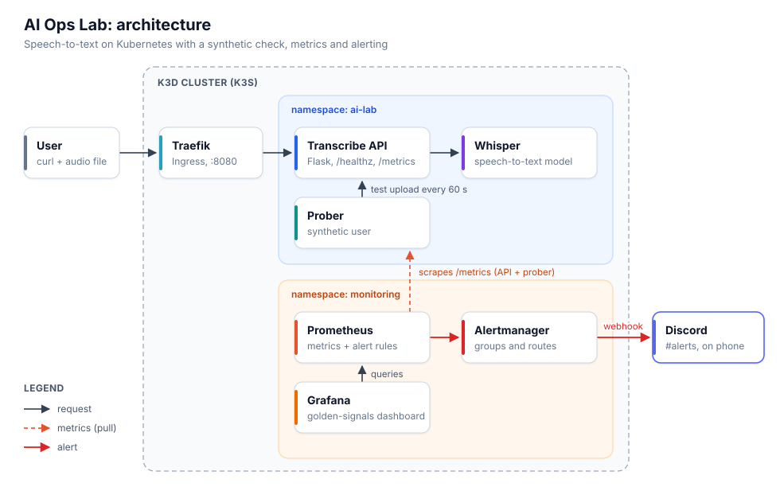
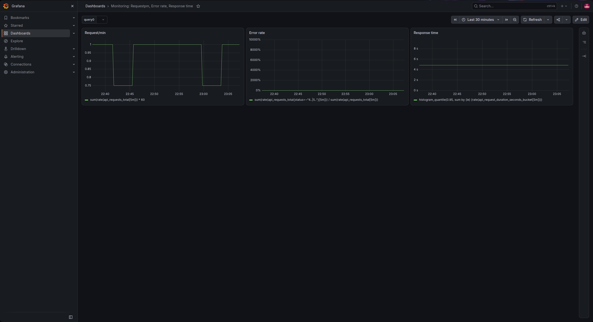
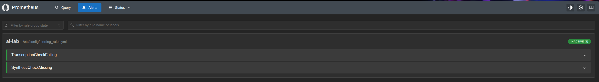

# AI Ops Lab

A small speech to text service running on Kubernetes, with monitoring, alerting and
troubleshooting to ensure .

You send an audio file to an API, it forwards the file to a Whisper
speech-to-text model, and you get the transcript back as JSON.

**The problem it solves:**
AI services can fail quietly, and often the users notice before the team does.
This lab adds a robot user that tests transcription every minute, nonstop.
If it stops working, an alert reaches my phone in about 4 minutes, even when
nobody is using the service.

## Architecture

## Key Components

- **Transcribe API** :Recieves audio file, forwards to Whisper, returns transcription.
- **Whisper** :Turns speech into text (ready made container).
- **Prober**  :Uploads a test clip every 60s.
- **Traefik** :Ingress routes requests to the right service.
- **Prometheus** :Pulls metrics every 60s, checks that it works
- **Alertmanager** :Gathers alerts and sends it to phone via webhook on Discord
- **Grafana** :Dashboard for 3/4 Golden rules

## Monitoring and alerts

The dashboard shows three of the four golden signals:

- **Traffic:** requests per minute
- **Errors:** failed requests
- **Latency:** p95 response time

Two alert rules, sent to Discord through Alertmanager:

`TranscriptionCheckFailing` No successful check for 3 minutes --> users are affected
`SyntheticCheckMissing` No data from the prober at all --> The monitor itself is down

**Measured:** with Whisper switched off, the alert fired after **4 min 12 s**
and cleared about 1 minute after recovery.

## Dashboards: 

`http://grafana.ailab.localhost:8080`

`http://prometheus.ailab.localhost:8080`

## Troubleshooting drills

I broke the system on purpose and diagnosed each failure from its symptoms.

| # | What I broke | Symptom | How I found it |
| --- | --- | --- | --- |
| 1 | Image tag that doesn't exist | `ImagePullBackOff` | `kubectl describe pod` events |
| 2 | App crashes at startup | `CrashLoopBackOff`, exit code 1 | `kubectl logs --previous` |
| 3 | Service selector doesn't match | Service has no endpoints | `kubectl get endpoints` |
| 4 | Wrong `targetPort` | Connection refused | Compared Service and container ports |
| 5 | Missing Secret | `CreateContainerConfigError` | `kubectl describe pod` |
| 6 | Memory limit too low | `OOMKilled`, exit code 137 | `kubectl describe pod` |
| 7 | Wrong Ingress host | 404 from Traefik | Compared Ingress host with the request |
| 8 | Whisper scaled to zero | Alert in Discord after 4 min 12 s | The monitoring found it |

## Limitations

- No persistent storage: Prometheus and Grafana lose data when their pods restart.
- The prober tests through the Service, not the Ingress, so Ingress failure would be missed.
- Monitoring runs on same machine, if machine goes down monitoring is also down
- 

## Future improvements

- Run prober through ingress - tests same path as users
- A job queue
- Logs with Loki
- Persistent storage for Prometheus and Grafana
- External uptime check independent from the clsuter
- CI with GitHub Actions - lint, test and build the images on every push
- GitOps with ArgoCD: merging to deploy, rollback is a merge revert
- Better Security: Secrets manager, only API being able to reach Whisper, VPN
- Error budget: if it's used up, slwo down changes fix reliability
